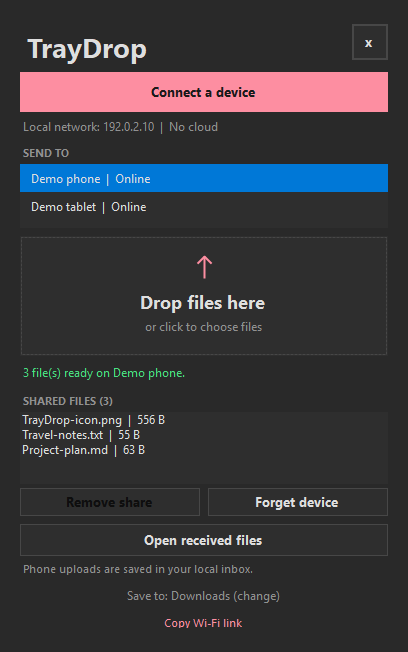
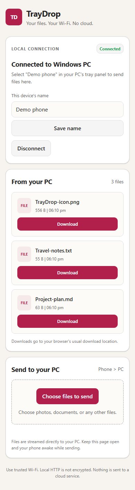
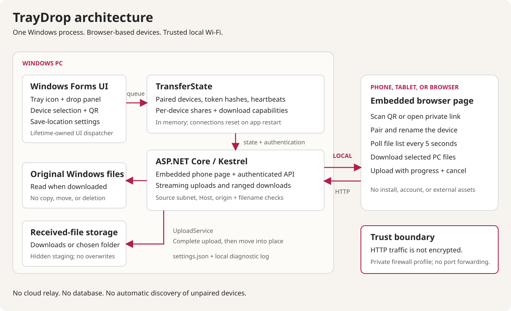

# TrayDrop

**Your files. Your Wi-Fi. No cloud.**

A native Windows tray app for two-way file transfers over your local network. Phones use a browser, not a companion app. There are no accounts or cloud services.

Select a connected device, drop files into a small panel above your Windows tray, and download them on your phone. Send files back from the phone page, with completed uploads saved to **Downloads** or a folder you choose.

**Current release:** [0.1.1 pre-release](https://github.com/istartedcoding/TrayDrop/releases/tag/v0.1.1), a Windows-first prototype for trusted local networks, licensed under [MIT](LICENSE). The current protocol uses HTTP, not encrypted transport. The release ZIP is portable and includes an optional per-user setup script for shortcuts and Windows startup. There is no MSI/MSIX installer or code-signing setup.

## Download for Windows

**[Download TrayDrop 0.1.1 for Windows x64](https://github.com/istartedcoding/TrayDrop/releases/download/v0.1.1/TrayDrop-0.1.1-win-x64.zip)**

Extract the ZIP, open its **TrayDrop** folder, and run **TrayDrop.exe** as a normal user. The self-contained release needs no separate .NET installation. It includes usage instructions and dependency notices.

For Start menu and desktop shortcuts, use the included **Install-TrayDrop.ps1** as described in the [usage guide](docs/HOW_TO_USE.md#optional-per-user-installation). Setup can also enable quiet startup with Windows.

See [how to use](docs/HOW_TO_USE.md), [release notes](docs/releases/v0.1.1.md), and [SHA-256 checksums](https://github.com/istartedcoding/TrayDrop/releases/download/v0.1.1/SHA256SUMS.txt).

**Trusted local networks only.** This unsigned pre-release uses unencrypted HTTP. Allow firewall access on Private networks only; do not expose its port to the internet.

## Documentation

- [How to use](docs/HOW_TO_USE.md): download, open, pair, transfer, change folders, and troubleshoot.
- [Architecture and API reference](docs/ARCHITECTURE.md): components, transfer sequences, storage, concurrency, network boundaries, and tests.
- [Screenshot gallery](docs/SCREENSHOTS.md): 15 screenshots of the Windows app and browser interface, with explanations.
- [GitHub publishing guide](docs/PUBLISHING.md): source preparation, licensing decisions, build verification, and release packaging.

## At a glance

| Capability | What it does |
| --- | --- |
| Tray-first Windows app | Starts in the notification area instead of opening a permanent desktop window. |
| Lower-right drop panel | An always-on-top panel stays available while you switch to Explorer. |
| QR and private-link pairing | Connect a phone on the same local network without installing a companion app. |
| Device-specific sharing | Select the receiving device before sharing. Each device has its own file list. |
| Two-way transfers | Windows shares downloadable originals; phones upload files directly to Windows. |
| Downloads by default | Received files use the Windows Downloads known folder, including redirected locations. |
| Configurable destination | Choose another writable folder and remember it across restarts. |
| Streaming transfers | File contents are streamed, with HTTP byte-range support for downloads. |
| Safer incoming storage | Validate filenames, avoid overwrites, and stage incomplete uploads separately. |
| Local-only operation | No account, database, cloud relay, or externally hosted phone-page assets. |

## In pictures

<table>
  <tr>
    <th>Windows: select a device and share files</th>
    <th>Phone: download without an app installation</th>
  </tr>
  <tr>
    <td valign="top"></td>
    <td valign="top"></td>
  </tr>
</table>

The [full gallery](docs/SCREENSHOTS.md) also covers tray controls, pairing, save-location settings, upload progress, completed uploads, and a wider browser layout. Captures use demo data; the QR code is not a live connection invitation.

## Architecture at a glance



TrayDrop runs the native UI and local web server inside **one Windows process**:

1. **Windows Forms** owns the tray icon, floating drop panel, pairing dialog, and destination settings.
2. **TransferState** tracks paired devices, heartbeat timestamps, file-specific download links, and received-file metadata in memory.
3. **ASP.NET Core/Kestrel** serves the embedded phone page and authenticated local HTTP endpoints.
4. **UploadService** streams incoming files through hidden staging and moves completed files into the selected destination.
5. **The phone browser** pairs, polls for its file list, starts downloads, and uploads files with progress and cancellation.

Dropping a Windows file makes it available to the selected device. It does **not** immediately push the bytes to the phone. Transfer begins when the phone chooses **Download**.

See the [architecture guide](docs/ARCHITECTURE.md) for component responsibilities, Mermaid sequence diagrams, API contracts, and the distinction between persistent files and session-only state.

## Use the app

1. If installed using the setup script, open **Start > TrayDrop** or the **TrayDrop** desktop shortcut to show the panel. Otherwise, download and extract the [Windows release](https://github.com/istartedcoding/TrayDrop/releases/tag/v0.1.1), then run **TrayDrop.exe** from the extracted **TrayDrop** folder. For development, use the documented `dotnet run` command instead. A direct launch without `--show` starts in the notification area. If its rose-colored icon is hidden, expand the tray's overflow menu.
2. Click the tray icon. A small, always-on-top panel opens at the lower-right corner of that screen.
3. Click **Connect a device**. Put your phone on the same Wi-Fi, then scan the QR code with its camera or open the copied private link in its browser.
4. The phone connects automatically and appears in **Send to**. You can rename it on the phone page.
5. **Windows to phone:** select the receiving device and drag files onto the drop zone. You can also click the zone to choose multiple files. The phone page updates automatically; tap **Download**.
6. **Phone to Windows:** tap **Choose files to send** on the phone page. Upload progress is shown, and Windows notifies you when each complete file is saved. Click **Open received files** to open the inbox.
7. Received files default to your actual Windows **Downloads** folder. Click **Save to: Downloads (change)** in the panel, or **Save location...** in the tray menu, to choose another folder. **Use Downloads** restores the default. The choice is remembered across app restarts.

The panel stays open while you switch to Explorer to drag files. Its **x** button or Escape hides it without stopping transfers. Right-click the tray icon and choose **Exit** to stop the app. Opening another copy brings the existing panel forward.

Windows might ask for firewall access. Allow TrayDrop on **Private networks only**. Do not run it as administrator; Windows can block drag-and-drop between apps with different elevation levels.

## Local data and transfer behavior

- Received files: your Windows Downloads folder by default, including redirected Downloads folders. You can change the destination in the app. Changes affect new uploads only; existing files are not moved. An upload already in progress finishes in the folder selected when it started.
- Settings: `%LOCALAPPDATA%\TrayDrop\settings.json`. Resetting to Downloads follows the Windows known-folder location, rather than hardcoding a profile path.
- Diagnostics: `%LOCALAPPDATA%\TrayDrop\Logs\TrayDrop.log`. The tray menu can open the log folder.
- Incoming filenames are checked for Windows compatibility. Existing files are never overwritten; duplicates receive a numbered suffix. Partial uploads are staged in a hidden `.traydrop-staging` folder inside the selected save folder, so final completion stays on the same volume.
- Files are streamed rather than loaded entirely into memory. Downloads support byte ranges. There is no app-imposed upload size limit, but available disk space and browser/OS limits still apply.
- Outgoing files are references to your originals, not duplicate copies. They are not moved into Downloads. Keep them in place and unchanged until downloaded. If an original changes, moves, or becomes unreadable, the phone shows an error. On a phone, the mobile browser controls the download destination.
- **Remove share**, **Forget device**, and **Clear shared links** revoke future downloads. They never delete original or received files. A download already in progress can finish.
- Pairing and outgoing download links last for the current app session. After restarting TrayDrop, scan its new QR code. Completed received files remain on disk.
- The phone polls every five seconds. Devices become offline after 45 seconds without contact. Keep the phone page in the foreground, particularly during uploads. Mobile browsers can suspend background tabs.
- The app retains the most recent 100 received-transfer records in memory, and the panel shows the latest receipt. All completed files remain in the selected folder.

## Connection and privacy

The link looks like `http://<your-PC-IPv4-address>:45823/#pair=<private-code>`. The app displays addresses from active Wi-Fi and Ethernet adapters. If several are available, choose the adapter used by your phone in the connection dialog.

Opening the private URL pairs a browser and makes it visible in the desktop device list. This is not a scan of every device on the network: an unconnected phone browser cannot announce itself. Multiple phones or other devices with browsers can connect.

Pairing uses an unpredictable secret, device sessions use separate tokens, and each download has its own file-scoped capability. A device only receives the files selected for it. Request source addresses, Host headers, and browser origins are checked. Uploaded files are never executed or served as web content.

**Use trusted local networks only.** HTTP traffic is not encrypted, and someone who obtains your private pairing link can connect. Do not expose the port to the internet or enable router port forwarding. This version uses IPv4 and does not implement native mobile apps, folder transfers, or discovery of devices that have not opened the phone page.

## Build and test

Development requires Windows and the .NET 10 SDK. The UI uses Windows Forms, the local server uses ASP.NET Core/Kestrel, QR generation uses QRCoder, and tests use MSTest.
Tests cover native file-drag events, pairing while the tray panel has no window handle, streamed HTTP transfers, and save-location persistence.

| Layer | Implementation |
| --- | --- |
| Desktop | C#, .NET 10, Windows Forms, Windows known-folder API |
| Transfer server | ASP.NET Core, Kestrel, streamed file responses |
| Phone page | Embedded HTML, CSS, and vanilla JavaScript |
| QR codes | QRCoder 1.8.1 |
| Settings and diagnostics | Local JSON settings and a rotating file log |
| Automated verification | MSTest 4.0.2, including actual local HTTP requests and native drag events |

The application does not require Node.js or a JavaScript build pipeline. The [phone page](src/TrayDrop.Core/Web/phone.html) is embedded into the core assembly during the .NET build.

```powershell
dotnet build .\TrayDrop.slnx --configuration Release
dotnet test .\tests\TrayDrop.Tests\TrayDrop.Tests.csproj --configuration Release
dotnet run --project .\src\TrayDrop\TrayDrop.csproj -- --show
```

Publish a self-contained Windows x64 app, with no separate .NET installation required:

```powershell
dotnet publish .\src\TrayDrop\TrayDrop.csproj --configuration Release --runtime win-x64 --self-contained true -p:PublishSingleFile=true -p:IncludeNativeLibrariesForSelfExtract=true -p:EnableCompressionInSingleFile=true --output .\artifacts\TrayDrop
```

The compiled phone page is embedded in the app. It is also available as the self-contained source [phone.html](src/TrayDrop.Core/Web/phone.html).

### Install for your Windows user

The release ZIP includes the setup script beside the executable; follow the [downloaded-release setup instructions](docs/HOW_TO_USE.md#optional-per-user-installation). From a source checkout, publish first, finish any transfers, exit an existing TrayDrop instance, then run:

```powershell
.\scripts\Install-TrayDrop.ps1 -StartWithWindows
```

The [setup script](scripts/Install-TrayDrop.ps1) copies the published app to `%LOCALAPPDATA%\Programs\TrayDrop` and creates Start menu and desktop shortcuts that open the panel. Windows sign-in starts it quietly in the tray. It requires no administrator privileges and preserves `%LOCALAPPDATA%\TrayDrop` settings and received files.

Omit `-StartWithWindows` to install for manual launching and remove the setup script's existing startup shortcut. Use `-SourceDirectory` for a different self-contained publish folder. Running instances must be exited explicitly; the script does not interrupt transfers, start the app, or change network/firewall settings. Existing installations are not updated automatically. See [how to use](docs/HOW_TO_USE.md) for startup controls and network requirements.

### Command-line options

| Option | Behavior |
| --- | --- |
| No arguments | Start in the tray on port `45823`. |
| `--show` | Open the floating panel when starting. |
| `--port 45824` | Use a different TCP port and generate connection links for it. |

Only one instance runs per Windows session. Opening another copy activates the running instance instead of creating a second server. Exit the existing app before launching a replacement build or changing its port.

### Verification at this milestone

The latest application regression run passed **54 test cases**:

| Area | Cases | Examples |
| --- | ---: | --- |
| Transfer state and networking | 5 | Pairing, the exact online timeout, device isolation, revocation, original-file changes, local-address policy |
| Uploads and filenames | 26 | Data-driven filename validation, byte-exact saves, duplicates, cancellation, empty files, destination changes |
| Save-location settings | 4 | First-run Downloads, remembered custom folders, reset semantics, invalid settings, failed writes |
| Local HTTP integration | 9 | Two-way transfers, authentication, ranges, request limits, malformed requests, rate limiting, configured folders |
| Native Windows interaction | 10 | Production drag events, hide/reopen behavior, disposed-panel recovery, activation, dialogs, and pairing/upload notifications |

The documentation captures separately exercised real native file-drag events, a **63-byte browser download**, and **256 KiB plus zero-byte browser uploads** against an isolated loopback server. Downloaded and received bytes were compared with their originals. Phone screenshots use a 390-pixel mobile viewport in headless Microsoft Edge, not a physical-device compatibility certification.

## Source layout

| Location | Responsibility |
| --- | --- |
| [TrayDrop](src/TrayDrop) | Windows application lifecycle, tray UI, dialogs, native folder lookup, and logging |
| [TrayDrop.Core](src/TrayDrop.Core) | Network policy, transfer state, settings, upload storage, and local HTTP server |
| [phone.html](src/TrayDrop.Core/Web/phone.html) | Self-contained browser interface |
| [TrayDrop.Tests](tests/TrayDrop.Tests) | Unit, HTTP integration, and Windows interaction tests |
| [docs](docs) | Architecture, screenshot gallery, and publishing guidance |

## Troubleshooting

- **No network address:** connect to Wi-Fi or Ethernet, then click **Refresh** in the connection dialog.
- **Phone cannot open the link:** check that both devices use the same local network and that Windows Firewall allows the published executable on Private networks. Guest Wi-Fi and access-point/client isolation often block communication between devices.
- **Wrong address:** select the real Wi-Fi/Ethernet adapter, not a virtual adapter or an unrelated network.
- **Device offline:** reopen or refresh its phone tab. If the app restarted or the device was forgotten, scan the new QR code.
- **Port already in use:** run `TrayDrop.exe --port 45824`. Copy or scan the newly displayed link.
- **Upload fails:** check free disk space and inbox permissions. Interrupted uploads are not added to the inbox, and their partial files are removed when the request ends.
- **Download fails:** check that the original file still exists, is unchanged, and is not locked by another application. Drop it again to create a new link.

Logs do not intentionally record pairing secrets, bearer tokens, request bodies, or file contents. Filenames can appear in local error messages. A crash or power loss can leave a `.part` file in the selected folder's hidden `.traydrop-staging` directory; completed files are only moved into the selected save folder after the upload finishes. If you choose a cloud-synced folder, its separate sync service can upload the saved files; TrayDrop itself only transfers over the local network.

## Current scope and possible next steps

Implemented today: a native Windows tray app, browser pairing, device-specific outgoing shares, browser uploads, Downloads defaults, remembered destinations, and local transfer diagnostics.

Not implemented today:

- Native Android or iOS applications, or desktop builds for macOS/Linux.
- Automatic discovery of devices that have not opened the connection page.
- Encrypted transport, explicit desktop approval for every new pairing, or cryptographic transfer checksums.
- Folder transfers, resumable uploads, or outgoing-transfer completion acknowledgements.
- An MSI/MSIX installer, signed binaries, automatic updates, or an automated release workflow. The included setup script supports optional per-user startup.

These are potential future directions, not promised release features. In particular, transport encryption and a reviewed pairing model should precede use on untrusted networks.

## Contributing and publishing

Build on Windows, run the test project, and update the relevant documentation when behavior changes. For an issue report, include the app version, browser/OS, a minimal reproduction, and a redacted error message. Do not attach private QR codes, bearer tokens, personal files, or unreviewed logs.

TrayDrop's original source and documentation use the [MIT license](LICENSE). Bundled components retain their own licenses; see [third-party notices](THIRD_PARTY_NOTICES.md). The [publishing checklist](docs/PUBLISHING.md) describes release preparation.
