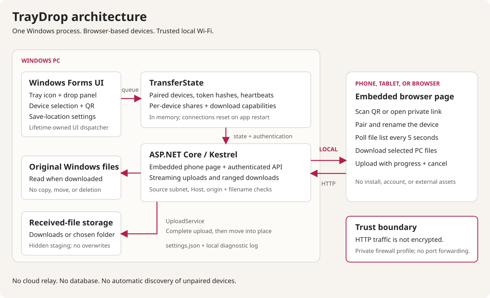
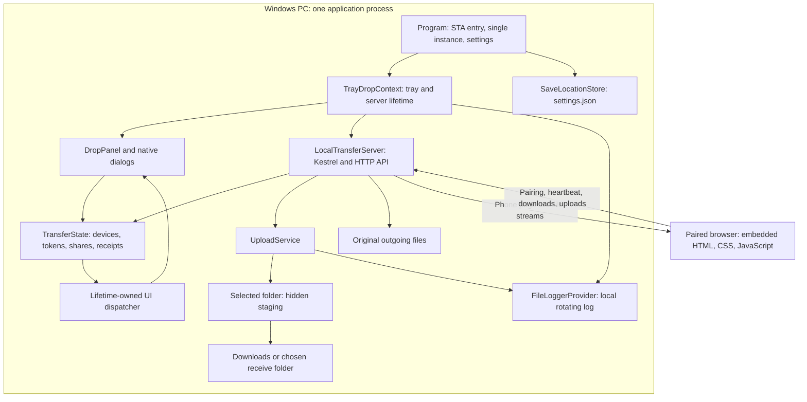
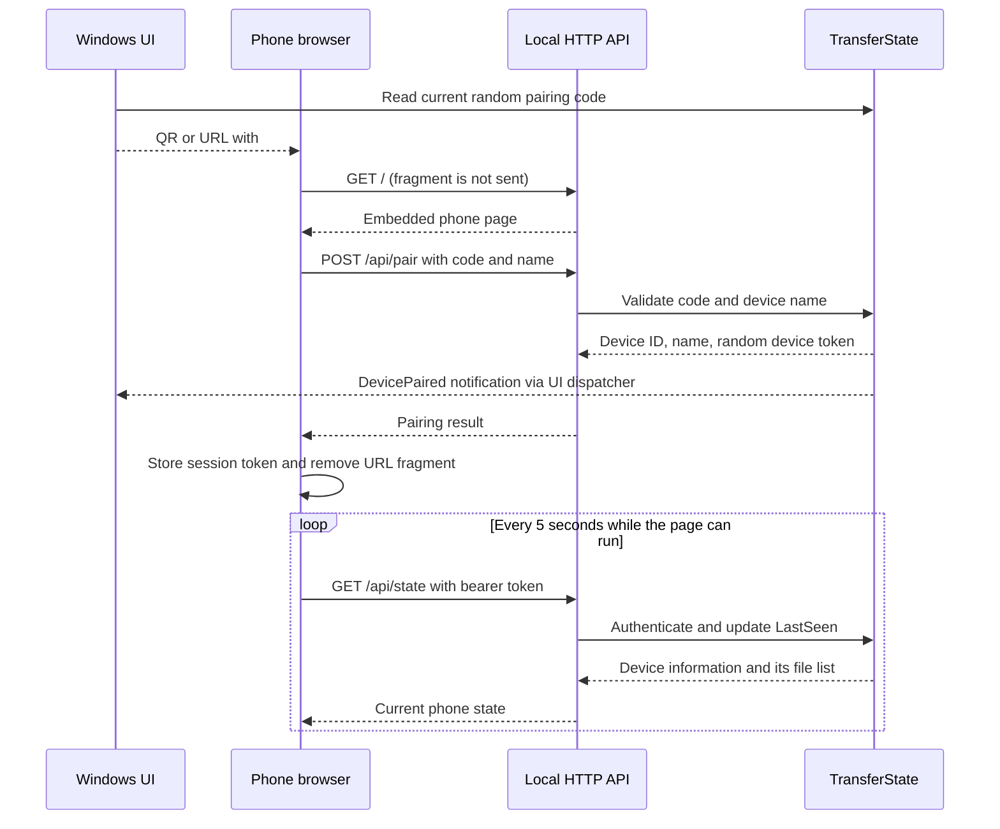
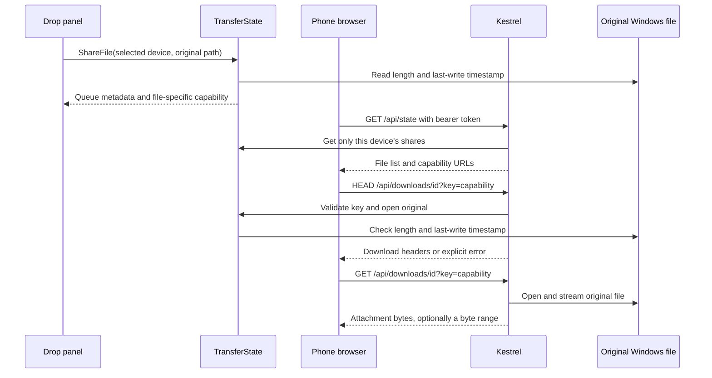
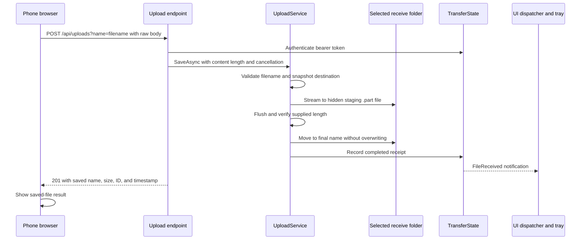

# TrayDrop architecture and API

[Application overview](../README.md) | [Screenshots](SCREENSHOTS.md) | [Publishing guide](PUBLISHING.md)

This document describes the implemented **0.1.1** application. Proposed extensions are explicitly marked as future work.

## 1. System model

TrayDrop is a Windows desktop application that also hosts a local web server. A phone, tablet, or other browser-equipped device connects to that server over the local network. There is no cloud relay, database, account service, or separately deployed frontend.

The PC is both the coordinator and the file server. Browser devices become visible after pairing. This is not a network scanner: an unconnected browser cannot announce its presence.

The optional [per-user setup script](../scripts/Install-TrayDrop.ps1) installs the published files, creates visible-launch shortcuts, and can add quiet Windows startup. It does not run inside the application, interrupt a running instance, or change the transfer protocol or network/firewall settings.





## 2. Components and source map

| Component | Responsibility | Source |
| --- | --- | --- |
| Program | STA startup, command-line arguments, Windows-session single-instance mutex and activation event, initial Downloads/settings resolution | [Program.cs](../src/TrayDrop/Program.cs) |
| TrayDropContext | Owns server, tray icon, menu, panel, dialogs, notifications, logging, and shutdown | [TrayDropContext.cs](../src/TrayDrop/TrayDropContext.cs) |
| DropPanel | Lower-right window, device selection, shared-file list, file picking, drag/drop, revocation, and latest receipt | [DropPanel.cs](../src/TrayDrop/DropPanel.cs) |
| NativeTheme and FileDropZone | Native styling, tray icon generation, keyboard activation, and production drag-event handlers | [NativeTheme.cs](../src/TrayDrop/NativeTheme.cs) |
| ConnectDeviceForm | Adapter selection, local connection URL, QR generation, and private-link copying | [ConnectDeviceForm.cs](../src/TrayDrop/ConnectDeviceForm.cs) |
| SaveLocationForm | Browse, reset to Downloads, save/cancel, and destination-change explanation | [SaveLocationForm.cs](../src/TrayDrop/SaveLocationForm.cs) |
| WindowsFolders | Resolves the actual Downloads known folder through `SHGetKnownFolderPath` | [WindowsFolders.cs](../src/TrayDrop/WindowsFolders.cs) |
| TransferState | Pairing, token authentication, presence, per-device shares, download capabilities, revocation, and receipt metadata | [TransferState.cs](../src/TrayDrop.Core/TransferState.cs) |
| LocalTransferServer | Kestrel setup, request policy, pairing rate limit, API routes, streamed downloads, and explicit problem responses | [LocalTransferServer.cs](../src/TrayDrop.Core/LocalTransferServer.cs) |
| UploadService and SafeFileName | Incoming filename checks, writable-folder preparation, streaming, cancellation cleanup, and collision-safe completion | [UploadService.cs](../src/TrayDrop.Core/UploadService.cs) |
| SaveLocationStore | Default/custom destination semantics and atomic JSON settings persistence | [SaveLocationStore.cs](../src/TrayDrop.Core/SaveLocationStore.cs) |
| NetworkDiscovery | Enumerates usable adapters and checks client subnets and request Host values | [NetworkDiscovery.cs](../src/TrayDrop.Core/NetworkDiscovery.cs) |
| FileLoggerProvider | Local log writes, size-based rotation, and a notification when logging fails | [FileLoggerProvider.cs](../src/TrayDrop/FileLoggerProvider.cs) |
| Phone page | Browser pairing, rename, session storage, polling, downloads, uploads, progress, cancellation, and theme detection | [phone.html](../src/TrayDrop.Core/Web/phone.html) |

The core project targets `net10.0`. The desktop and test projects target `net10.0-windows` and use Windows Forms. The shipped desktop app is Windows-only, even though the protocol and most transfer logic are separated from its UI.

## 3. Pairing and device presence



- Pairing codes, device tokens, and file download keys each use 32 random bytes encoded as 64 hexadecimal characters.
- Pairing codes and file keys are compared with a fixed-time comparison.
- Device-token lookups use SHA-256 hashes in server memory. The browser retains its token in `sessionStorage`.
- Device names are trimmed and must contain 1 to 48 characters without control characters.
- A device is online when its last authenticated contact is no more than 45 seconds old.
- The phone polls every 5 seconds. The native panel refreshes every 2 seconds.
- Browser visibility changes trigger another state refresh. Mobile background-tab suspension can still interrupt presence and uploads.
- A valid saved browser session is restored when possible. A new pairing fragment causes a reload when idle; during an upload, the page warns instead.
- Anyone who possesses the live pairing invitation can pair without a separate desktop approval prompt.

The pairing fragment is absent from the initial HTTP `GET`, but the browser subsequently sends its code in a pairing request over **unencrypted HTTP**. Fragment use is not transport encryption.

## 4. Windows-to-phone download flow



Sharing records an original path, size, last-write timestamp, target device, and random file key. It does not copy the file into a send directory or into Downloads.

The original is opened when requested. The server verifies its length and last-write timestamp before returning a streamed attachment. These are metadata checks, not a cryptographic content checksum.

Downloads support `HEAD` and HTTP byte ranges. Browser support for actual download resumption depends on that browser. The server uses `application/octet-stream`, an attachment filename, and `nosniff`, rather than serving uploaded or shared documents as executable web content.

**Important semantics:**

- Each authenticated phone-state response contains only that device's queued files.
- Download requests use a file-scoped URL capability, not a bearer header, so ordinary browser downloads work.
- A copied download capability can be used by another allowed local-network client. Keep those URLs private.
- A `GET` increments the request counter. The counter is not proof of a completed download; retries and range requests can also count.
- Removing a share, forgetting its device, or clearing all links revokes future access without deleting originals.
- A download whose stream is already open can finish after revocation.
- There is no outgoing push protocol, outgoing progress display, or completion acknowledgement.

## 5. Phone-to-Windows upload flow



The browser sends selected files sequentially using `XMLHttpRequest` so it can show upload progress. The endpoint accepts a raw binary request body, not multipart form data.

Storage uses 64 KiB asynchronous copy buffers. Each upload snapshots the destination before copying, stages inside that destination's hidden `.traydrop-staging` directory, and moves the completed file on the same volume.

Incoming Windows filenames reject paths, control characters, forbidden characters, trailing dots/spaces, overlong names, and reserved device names. If a destination already exists, completion tries a numbered suffix, such as `photo (1).jpg`, without overwriting it. Final moves are serialized within the upload service.

There is no app-imposed upload size ceiling. Available disk space, permissions, filesystem limits, browser limits, and network reliability still apply.

Cancellation aborts the active upload and skips remaining queued files. Earlier completed files remain saved. Incomplete staging files are removed when the request ends, with an explicit local log error if cleanup fails. A crash or power loss can leave a staging file; startup does not implement automatic stale-file cleanup.

Zero-byte files are valid. Uploads are not resumable, and the application does not run antivirus scanning or execute received files.

## 6. Storage and persistence

| Data | Location or lifetime |
| --- | --- |
| Completed incoming files | Actual Windows Downloads known folder, or the user's selected destination |
| Active upload staging | Hidden `.traydrop-staging` subfolder inside the destination selected when the upload starts |
| Destination settings | `%LOCALAPPDATA%\TrayDrop\settings.json` |
| Current diagnostic log | `%LOCALAPPDATA%\TrayDrop\Logs\TrayDrop.log` |
| Rotated diagnostic log | The same log path with `.previous` appended |
| Pairing code, device sessions, and outgoing shares | In memory for the current app process |
| Received-transfer records | Latest 100 in memory; the panel displays the latest receipt |
| Browser device session | `sessionStorage` for the browser tab/session |

The native app resolves Downloads with the Windows known-folder API instead of assuming a profile-directory path. When using the core server independently without an explicit receive directory, its fallback is a `Received` folder under its supplied data directory. The native application always supplies the resolved user destination.

### Settings contract

Follow the Windows default Downloads location:

```json
{
  "receiveDirectory": null
}
```

Remember an explicit custom location:

```json
{
  "receiveDirectory": "D:\\Transfers\\Incoming"
}
```

A missing settings file also means the default. An explicitly selected Downloads path is still a fixed custom path; **Use Downloads** restores known-folder-following semantics.

The UI prepares the destination and checks writability before saving it. Settings are written to an owned temporary file alongside the settings file and moved into place. Failed writes keep the previous setting. Invalid JSON or invalid saved paths produce an explicit error instead of silently resetting.

A destination change applies to new uploads only. It does not move existing receipts, copy outgoing originals, or change the destination of an active upload.

If a user chooses a cloud-synced folder, that folder's separate sync service may upload its contents. TrayDrop itself still uses only the local transfer connection.

## 7. Native lifecycle and concurrency

Startup creates a Windows-session-scoped named mutex and activation event. A second launch signals the existing application and exits. The first instance starts Kestrel, makes the tray icon available, and enters the Windows Forms message loop.

The floating panel is borderless, always on top, and positioned at the lower-right of the screen containing the cursor. Its logical client size is 408 by 652 pixels, with DPI scaling and work-area height adjustment. User close and Escape hide it; **Exit** in the tray menu ends the process and server.

The application context caches the panel but recreates it if its previous window has been disposed. Tray clicks, menu actions, second-launch activation, and server notifications resolve the current live panel rather than retaining callbacks to a disposed form. Recreating the window does not restart Kestrel, change the pairing code, disconnect devices, remove shared files, or reset the receive folder.

Server notifications marshal through a dedicated, invisible dispatcher control whose native handle lasts for the application lifetime. They do not depend on the floating panel having a window handle. This is important when the app remains in the tray while the panel is hidden or its handle has been destroyed.

State mutations use a lock. Pairing and received-file notifications are raised outside that state lock. The current receive directory uses volatile reads/writes, while each upload retains its own destination snapshot.

Shutdown unregisters activation callbacks, removes event handlers, hides/disposes the tray resources, stops the server, and disposes the UI. Server shutdown has a five-second timeout after which active transfers can be cancelled.

## 8. Local networking and trust boundaries

The production server binds IPv4 on port `45823` by default. `--port` selects another port. Active Wi-Fi and Ethernet IPv4 addresses are offered in the connection dialog; IPv6, loopback adapter addresses, and link-local automatic addresses are not offered as phone connection addresses.

Selecting an adapter changes the displayed/copied URL, not the production listener binding. The server normally listens on all IPv4 interfaces.

Implemented request controls:

- Allow loopback clients and clients matching a usable local adapter's IPv4 subnet.
- Allow request Host values for localhost, loopback addresses, or the PC's known adapter addresses.
- Reject browser mutation requests with a different origin when an `Origin` header is supplied.
- Require a valid pairing code, device bearer token, or file capability for the relevant action.
- Limit pairing to 12 attempts per minute per client IP, using a fixed window and no queue.
- Limit non-upload request bodies to 64 KiB.
- Apply `no-store`, `nosniff`, `no-referrer`, and a content security policy.
- Serve the phone interface without external scripts, fonts, or other page assets.

These controls are not a replacement for TLS, Windows Firewall, a hostile-network threat model, or a security review. HTTP pairing codes, bearer tokens, file keys, and file contents can be observed by someone able to inspect the network traffic.

Use **trusted local networks**, allow the executable through Windows Firewall on **Private networks only**, and never enable router port forwarding for this app.

## 9. HTTP API reference

The native application's configured address and port are the API origin. JSON property names use camel case. Error responses use problem-details JSON.

| Method | Path | Authorization | Request | Success |
| --- | --- | --- | --- | --- |
| `GET` | `/` | None | None | Embedded phone HTML |
| `POST` | `/api/pair` | Pairing code in body | JSON `code`, `name` | `200`: device ID, name, token |
| `GET` | `/api/state` | Device bearer token | None | `200`: computer name, device metadata, this device's files |
| `PATCH` | `/api/device` | Device bearer token | JSON `name` | `200`: updated device metadata |
| `DELETE` | `/api/device` | Device bearer token | None | `204`: device and its shares removed |
| `GET`, `HEAD` | `/api/downloads/{id}?key=...` | File-scoped key | Optional range headers | `200` or ranged response with attachment headers |
| `POST` | `/api/uploads?name=...` | Device bearer token | Raw file body | `201`: saved receipt metadata |

Example pairing body, using placeholders rather than a real invitation:

```json
{
  "code": "<private-code-from-current-QR>",
  "name": "My phone"
}
```

Upload requests must supply exactly one `name` query value and URL-encode the filename. The browser sends `Content-Type: application/octet-stream` and `Authorization: Bearer <device-token>`.

Upload success includes `id`, `name`, `size`, and `receivedAt`. It deliberately omits the PC's full filesystem path.

Common explicit error conditions:

| Status | Meaning |
| --- | --- |
| `400` | Invalid device name, malformed request, invalid filename, or incomplete upload |
| `401` | Invalid pairing code or missing/expired/revoked device authentication |
| `403` | Rejected network client, Host value, or browser origin |
| `404` | Missing/revoked download capability; unmatched routes also return not found |
| `409` | Original shared file changed |
| `410` | Original shared file moved or deleted |
| `429` | Pairing rate limit exceeded |
| `499` | Best-effort, non-standard cancellation response; an aborted browser request may not receive it |
| `500` | Unexpected server error, reported locally |
| `503` | Original file cannot currently be read |
| `507` | Incoming upload cannot be saved, for example because of disk space or permissions |

## 10. Verification and extension points

The documented application milestone passed **54 MSTest cases**. Filename tests are data-driven, so the case count is larger than the number of test methods.

| Test file | Focus |
| --- | --- |
| [TransferStateTests.cs](../tests/TrayDrop.Tests/TransferStateTests.cs) | Pairing, presence threshold, device isolation, revocation, original metadata, and network policy |
| [UploadServiceTests.cs](../tests/TrayDrop.Tests/UploadServiceTests.cs) | Filenames, exact bytes, collisions, empty/incomplete uploads, cancellation, and destination snapshots |
| [SaveLocationTests.cs](../tests/TrayDrop.Tests/SaveLocationTests.cs) | Defaults, persistence, reset behavior, corruption, and failed settings writes |
| [LocalServerTests.cs](../tests/TrayDrop.Tests/LocalServerTests.cs) | Real HTTP transfers, authentication, headers, ranges, malformed requests, limits, rate limiting, and folders |
| [WindowsInteractionTests.cs](../tests/TrayDrop.Tests/WindowsInteractionTests.cs) | Production native drag events, hide/reopen behavior, disposed-panel recovery, retained phone authorization and shared files, activation, and notifications without the panel's handle |

The [screenshot capture](SCREENSHOTS.md#capture-and-privacy-notes) also validated native file sharing, a byte-exact browser download, a 256 KiB upload, and an empty upload against a separate loopback-only demo server. This is not a throughput benchmark, physical-phone compatibility matrix, or security certification.

Likely future changes belong at these existing boundaries:

- **Encrypted transport or stronger pairing approval:** local server, pairing state, connection dialog, and browser connection handling.
- **Native mobile clients:** reuse the documented protocol, with explicit decisions about transport and token storage.
- **Discovery before browser pairing:** requires a new native discovery mechanism; adapter enumeration is not peer discovery.
- **Checksums, resumable uploads, or persistent queues:** transfer state, upload service, and API contracts.
- **MSI/MSIX installer, code signing, or automatic updates:** desktop packaging and release tooling.

None of these extensions is implemented in the current milestone.
