# TrayDrop screenshot gallery

[Application overview](../README.md) | [Architecture](ARCHITECTURE.md) | [Publishing guide](PUBLISHING.md)

Fifteen captures show the implemented Windows app and browser interface. Click an image to open its full-resolution PNG.

## Windows application

### 1. Tray-only entry point

The tray menu opens the panel, starts pairing, copies the local link, opens received files and logs, changes the destination, clears shares, or exits. Closing the floating panel is different from choosing **Exit**.

[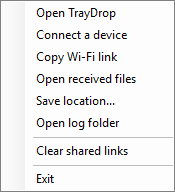](images/windows-tray-menu.png)

### 2. First-open panel

The lower-right panel provides a device list and file drop zone. Before pairing, there are no receiving devices. The bottom controls open received files, change the save location, and copy the Wi-Fi link.

[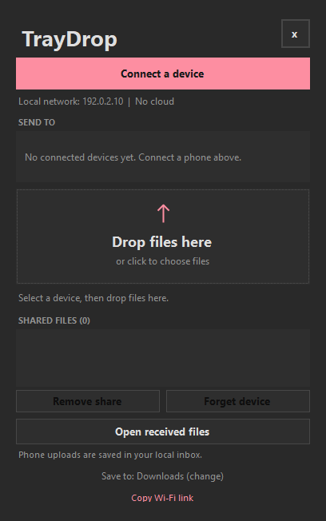](images/windows-empty.png)

### 3. QR pairing and network selection

Choose the adapter on the phone's network, then scan the QR code or copy the private link. The displayed documentation QR encodes a reserved example address and `demo-only`; it cannot pair with a running app.

[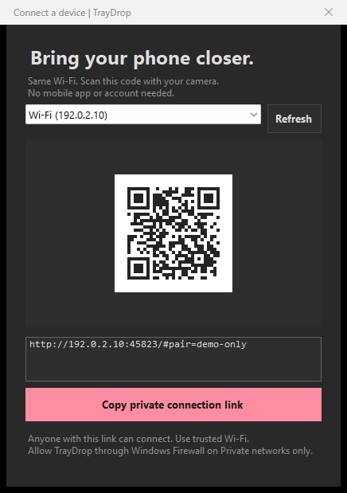](images/windows-pairing.png)

### 4. Multiple connected devices

Devices appear after opening the connection page and pairing. The selected row determines which device receives newly shared files. This capture shows a demo phone and tablet.

[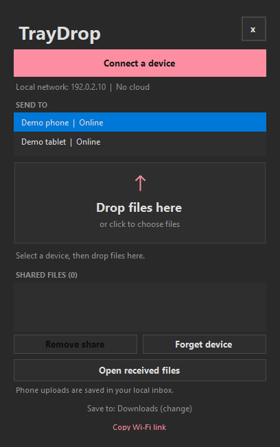](images/windows-connected.png)

### 5. Files queued for one device

Three files have been added through the native file-drag event pipeline. The list represents available download links, not already-completed phone downloads.

[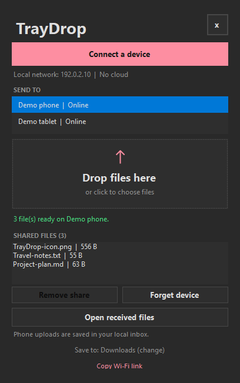](images/windows-shared-files.png)

### 6. Configurable received-file destination

Received files default to Downloads. **Browse...** selects another folder, **Use Downloads** restores the known-folder default, and **Save** remembers the choice. Existing files and sent originals are not moved.

[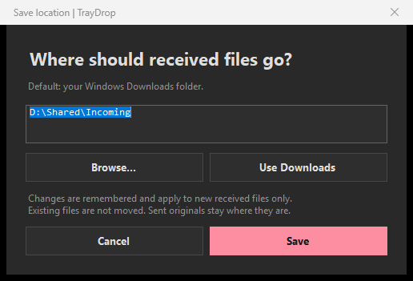](images/windows-save-custom.png)

### 7. Receipt after a browser upload

The panel displays the latest completed receipt and provides a shortcut to its save folder. The `requested` text on an outgoing share counts GET requests, not completed-download acknowledgements.

[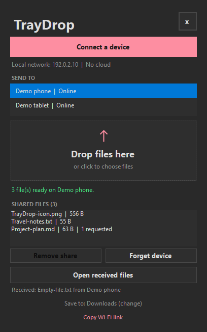](images/windows-received-file.png)

## Phone browser

### 8. No pairing invitation yet

Opening the root page without a pairing invitation or restored session explains how to connect. The disabled connect button prevents an invitation-free pairing attempt.

[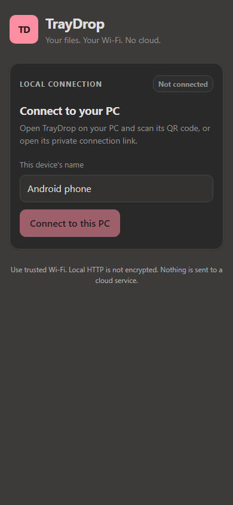](images/phone-not-connected.png)

### 9. Connected and ready

A newly paired browser displays the PC name, editable device name, and both transfer directions. Until the PC shares files with this device, the download list is empty.

[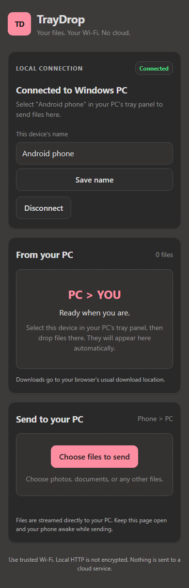](images/phone-ready-dark.png)

### 10. Download list in dark mode

The phone page follows system theme unless overridden for a preview. Each queued file has its own download button. This capture also shows the successful device-rename message.

[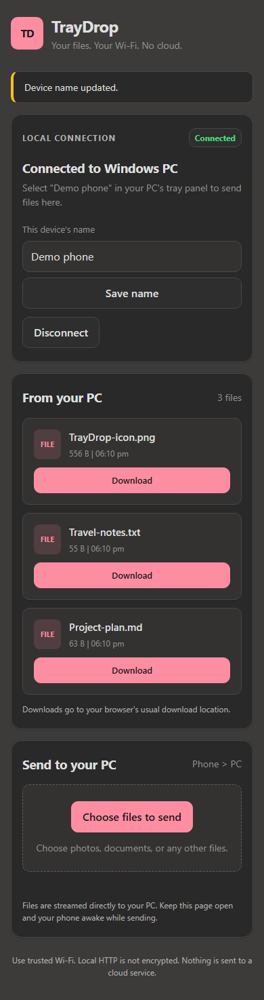](images/phone-files-dark.png)

### 11. Download list in light mode

The same self-contained page supports a light theme. No separate frontend bundle or externally hosted theme assets are required.

[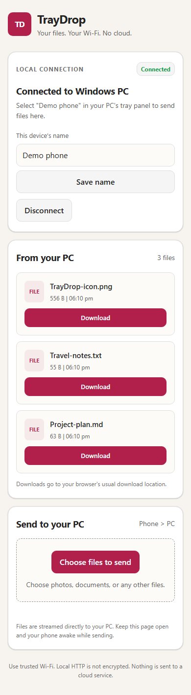](images/phone-files-light.png)

### 12. Download started

The page checks the link with HEAD before starting the browser download. The saved demo document was compared byte-for-byte with the original Windows file.

### 13. Upload progress and queued files

The first file is actively sending and the next file is waiting. **Cancel sending** aborts the active request and prevents later files from being sent. Network throttling was used only for this demo to make real progress visible.

[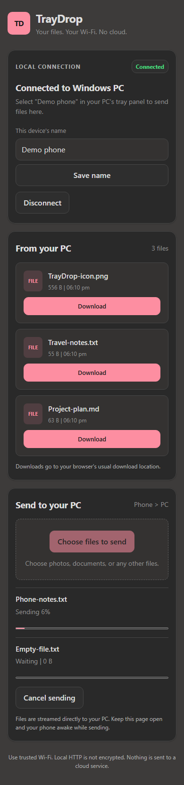](images/phone-upload-progress.png)

### 14. Completed uploads, including an empty file

The browser displays the saved filename and size for each completed upload. Both the 256 KiB text file and the zero-byte file were verified in the demo receive folder.

[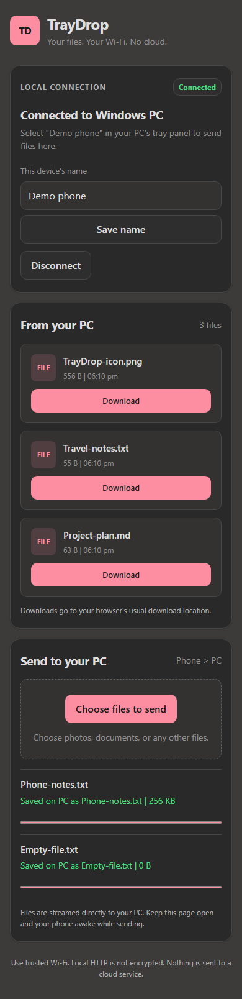](images/phone-upload-complete.png)

## Wider browser layout

### 15. The same interface on a larger screen

The browser client is not restricted to phone-sized screens. This capture renders the same authenticated interface at a 1024-pixel width.

[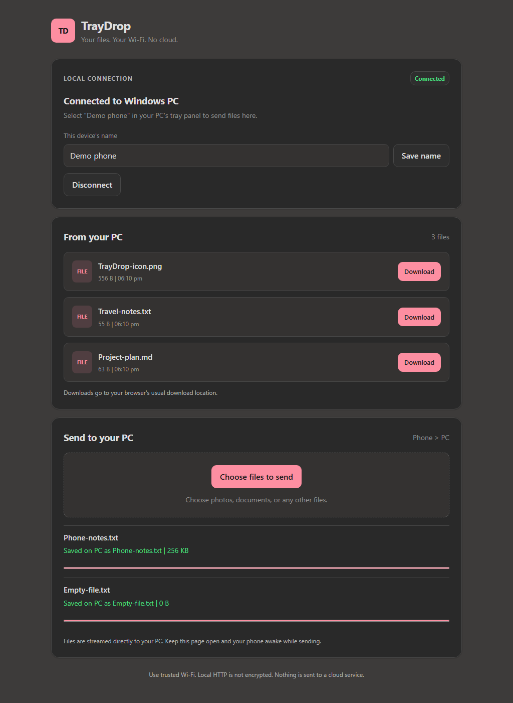](images/browser-overview.png)

## Capture and privacy notes

- Windows images were rendered from the production Windows Forms classes using an isolated demo fixture and target-only window capture. No full-desktop screenshot was taken.
- Browser images were captured from the actual embedded page, served by a separate **loopback-only** demo server. Mobile captures use a **390-pixel** viewport in headless Microsoft Edge. They are not photographs or physical-phone test results.
- The wider browser capture uses a 1024-pixel viewport. The native panel capture uses its 408 by 652 logical-pixel size.
- Device names, PC name, file contents, network address, and destination paths are demonstration values. `192.0.2.10` is a documentation address, not a real connection endpoint.
- The public QR image uses `demo-only`, not any active pairing code. No bearer tokens, file keys, real user-profile paths, or live phone-session screenshots are included.
- The capture exercised actual native drag handlers and a real browser download, then compared the downloaded **63 bytes** with the original. Browser uploads of **262,144 bytes** and **0 bytes** were also compared with the saved files.
- The progress image shows a real XHR transfer at **6%** under temporary network throttling. That figure is not a performance claim.
- The user's running app, selected destination, device name, and phone session were not used or changed for the captures.

The [architecture diagram](images/architecture.svg) is a separate explanatory diagram, not an application screenshot.
